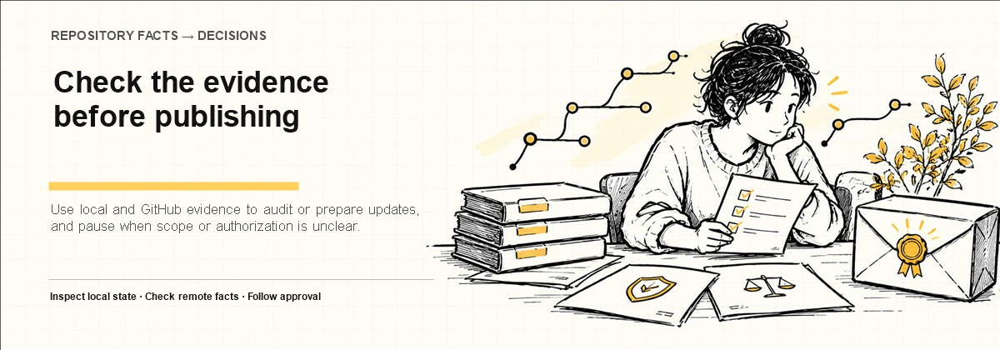
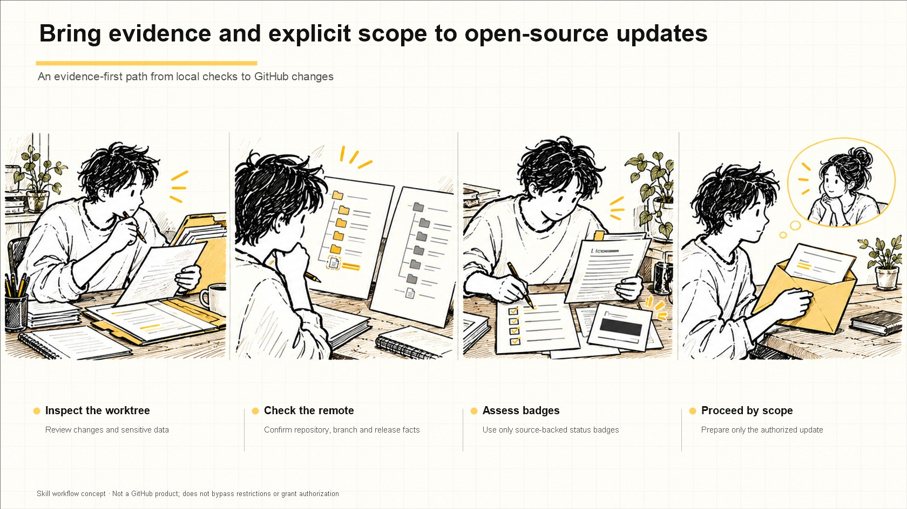

# GitHub OSS Release Skill

> Use local and GitHub evidence to audit or prepare updates, and pause when scope or authorization is unclear.

  [](LICENSE)




中文封面与配图：[封面](assets/portfolio-promo-2026-11-02/cover-zh.jpg) · [配图](assets/portfolio-promo-2026-11-02/overview-zh.jpg)

[简体中文](README.md)

`github-oss-release` is a community open-source Codex Skill for auditing,
initial publication, project updates, migration, PR and Dependabot review,
merges, and GitHub Releases using local evidence and read-only platform
evidence. The current Skill version is `2.2.0`.

It is not an official GitHub or OpenAI product and does not represent either
company. It cannot guarantee that an account will never be restricted, and it
does not automatically create Stars, Forks, Follows, Issues, PRs, or Comments.

## Workflow diagram (AI concept illustration)
### Workflow illustration (concept only)



> AI-generated concept illustration: workflow only, not a real interface, runtime data, or result.

## Problems it addresses

- Separates local readiness, established remote facts, and the current task result.
- Fails closed around dirty worktrees, unsafe history, secrets, licensing, CI, and authentication conflicts.
- Requires an exact file manifest, local-only report, and action-specific authorization.
- Binds HTTPS push credentials to verified `workflow` scope evidence when workflow files change.
- Assesses CI, License, Release, version, Coverage, CodeQL, and dependency-audit badges from real evidence, rejecting static claims.
- Stops on 401, 403, 429, Push Protection, non-fast-forward, and unknown targets instead of bypassing controls.

## Supported task types

`DISCOVERY_ONLY`, `PRE_PUBLISH_AUDIT`, `INITIAL_PUBLICATION`,
`PROJECT_UPDATE`, `BRANCH_AND_PR_UPDATE`, `PR_REVIEW`, `PR_MERGE`,
`DEPENDABOT_REVIEW`, `DEPENDABOT_MERGE`, `RELEASE_PUBLICATION`,
`REMOTE_MIGRATION`, `AUTH_DIAGNOSIS`, `AUTH_REMEDIATION`,
`VISUAL_ASSET_PUBLICATION`, `BADGE_AUDIT`, `BADGE_UPDATE`,
`PORTFOLIO_BADGE_AUDIT`, `PORTFOLIO_BADGE_ROLLOUT`, and `INCIDENT_RECOVERY`.

A task type routes the workflow; it does not authorize a GitHub write.

## Evidence-first badge assessment

A badge is a public factual claim, not decoration. `BADGE_POLICY = EVIDENCE_FIRST`:
recommend a badge only when verifiable evidence matches the target owner,
repository, default branch, Workflow, License, Release, version, or quality
source. Badge statuses are `VERIFIED_READY`, `REQUIRES_QUALITY_SETUP`,
`NOT_APPLICABLE`, `NOT_RECOMMENDED`, and `BLOCKED_INVALID_EVIDENCE`.

`BADGE_AUDIT` assesses one project read-only; `BADGE_UPDATE` updates one named
project; `PORTFOLIO_BADGE_AUDIT` assesses multiple repositories read-only;
`PORTFOLIO_BADGE_ROLLOUT` updates only an explicitly approved repository list.
Recommend 2–6 badges by default and keep one badge per meaning. Missing CI,
CodeQL, or Coverage produces a quality-setup recommendation, not an automatic
Workflow. Run `scripts/assess_badges.py` for JSON assessment and
`scripts/validate_badges.py` for Markdown, URL, ownership, bilingual README,
and static-claim validation.

## Installation

Use a trusted Codex Skill Installer to import the repository root, or copy the
complete repository into the Codex Skills directory under the name
`github-oss-release`. Verify that these paths exist:

- `SKILL.md`
- `agents/`
- `references/`
- `scripts/`
- `templates/`
- `tests/`

Never embed credentials in a repository URL, configuration, log, or Skill
file. Invoke the Skill from a new task after installation.

## Invocation

State the Skill, one task type, the target owner/repository, and the intended
action in the Codex task:

```text
Use $github-oss-release
TASK_TYPE = PRE_PUBLISH_AUDIT
Target = <owner>/<repository>
Action = audit only; no GitHub write
```

If the type, target, or action cannot be verified, the Skill should ask one
focused question and remain read-only.

## Common Prompt Recipes

Open the real project root, start a new Codex task, and invoke
`$github-oss-release`. Replace `<github-owner>`, `<repository-name>`,
`<owner/repository>`, and `<public-or-private>` with the target values. Run the
read-only audit first, then authorize an ordinary Push only after it passes.
Never use Force Push. Local PRE/POST/UPDATE reports stay ignored and do not enter
the public repository.

### 1. Pre-push audit

```text
$github-oss-release

TASK_TYPE = PRE_PUBLISH_AUDIT

Run a complete GitHub pre-publication audit for the current project.

Target GitHub account:
<github-owner>

Target repository name:
<repository-name>

This step is read-only. Create a local-only PRE-PUBLISH-REPORT. Do not modify
project files, Commit, Push, or perform any GitHub write. Return the result in
Simplified Chinese first.
```

### 2. First push for a new project

Step one prepares the project and local report:

```text
$github-oss-release

TASK_TYPE = INITIAL_PUBLICATION

Prepare the current project for its first GitHub open-source publication.

Target GitHub account:
<github-owner>

Target repository name:
<repository-name>

Target repository visibility:
<public-or-private>

Do not Commit, create the remote repository, or Push in this step.
```

Step two authorizes publication only when `READY_TO_PUBLISH = YES` and the
audited state has not drifted:

```text
$github-oss-release

APPROVE_GITHUB_PUBLISH

Continue the current INITIAL_PUBLICATION task.

Authorized GitHub account:
<github-owner>

Authorized target repository:
<owner/repository>

Authorized repository visibility:
<public-or-private>

Use only the exact file manifest, an ordinary Commit, and an ordinary Push.
Do not Force Push, overwrite a non-empty repository, commit local reports, or
create a Tag/Release. Stop safely on any high-risk condition.
```

### 3. Update push for a published project

Step one prepares only the intended update:

```text
$github-oss-release

TASK_TYPE = PROJECT_UPDATE

Prepare a safe update for the current published GitHub project.

Target GitHub account:
<github-owner>

Separate current-task changes from unrelated existing changes; check remote,
Workflow, Secret, License, and quality gates; and create a local-only
PRE-PUBLISH-REPORT. Do not Commit, Push, or create a Pull Request in this step.
```

Step two commits only files approved by the report:

```text
$github-oss-release

APPROVE_GITHUB_PUBLISH

Continue the current PROJECT_UPDATE task.

Authorized GitHub account:
<github-owner>

Commit only the current changes approved by PRE-PUBLISH-REPORT. Use exact
Staging and an ordinary Push. If main requires a PR, create an update branch
and Pull Request, but do not auto-merge or bypass protection.
```

- [Complete Prompt Recipes](docs/usage-prompts.en.md)

## Initial publication

1. Discover structure, version, configured commands, Git state, and existing remotes.
2. Record only credential presence, account identity, and call outcome.
3. Verify that the target is absent or empty; route a non-empty target to an existing-remote workflow.
4. Choose safe-history preservation, an isolated clean worktree, or a fresh public history.
5. Check standard files, secrets/privacy, third-party licensing, quality, UTF-8, links, and artifacts.
6. Build an exact relative manifest and an ignored local `PRE-PUBLISH-REPORT.md`.
7. Allow exact staging, an ordinary commit, and an ordinary push only when the report says
   `READY_TO_PUBLISH = YES` and the user supplies exact `APPROVE_GITHUB_PUBLISH`.
8. Re-verify the target, commit, CI/CodeQL/Dependabot state, and return a Chinese result after a write.

The Skill prohibits `git add .`, `git add -A`, force-push, history rewriting,
and Push Protection bypass. Excluding or repairing history needs separate
`APPROVE_GIT_HISTORY_REMEDIATION` authorization.

## Project updates

Compare local and remote HEAD, branch, worktree ownership, and change ownership
first. A clean, low-risk, explicit update may use an ordinary direct push;
mixed, larger, or review-sensitive work should use a branch and PR. Re-run the
affected gates, generate an exact manifest, and obtain target-specific approval.
If the update changes `.github/workflows/**`, complete a pre-push `workflow`
scope check bound to the actual HTTPS credential source.

## PRs and Dependabot

- `PR_REVIEW` and `DEPENDABOT_REVIEW` are read-only by default.
- A merge is limited to a named PR and requires `APPROVE_GITHUB_PR_MERGE`.
- Review version span, release notes, changed files, dependency relations, CI, and security risk per PR.
- Approval for one PR never extends to another PR, branch, repository, Release, or setting.

## Remote migration

Verify old and new owners, target state, history relationship, permissions, and
local links before migration. An old remote is evidence only and must not be
silently adopted or rewritten. Stop on a non-fast-forward or non-empty target;
use a normal branch/PR or safe fast-forward integration, never force-push.

## GitHub authentication conflicts

The Skill records only whether `GH_TOKEN`/`GITHUB_TOKEN` is set, the
CLI/API/SSH account identity, and call outcomes. It never reads or prints token
values. Because an environment token may mask keyring credentials, diagnose it
once in a temporary clean subprocess. Stop after one diagnostic check on 401,
403, or 429; do not rotate accounts, IPs, or proxies to evade a restriction.

## Authorization words

- `APPROVE_GITHUB_PUBLISH`: the named project, owner/repository, approved files, ordinary commit/push, and post-write verification.
- `APPROVE_GITHUB_PR_MERGE`: one named PR only.
- `APPROVE_GITHUB_RELEASE`: one named tag/release only.
- `APPROVE_GIT_HISTORY_REMEDIATION`: one named history operation only.
- `APPROVE_REMOTE_DESTRUCTIVE_CHANGE`: one named destructive remote operation only.
- `APPROVE_GITHUB_WORKFLOW_SCOPE_REFRESH`: one `workflow` scope refresh for the verified account; publish approval never includes it implicitly.

Authorization never expands across owners, repositories, branches, PRs,
Releases, settings, or secrets.

## Resume checkpoints

Resume state belongs in ignored
`.local-audit/github-oss-release-state.json`. Compare project HEAD and relevant
file hashes, and invalidate only gates whose inputs changed. Never resume a
write after the owner, repository, branch, approval scope, or target state changes.

## Chinese result policy

The final result begins with `# 用户结果摘要`, followed by a Chinese result
table. Problems appear only when they exist, and machine fields remain under
`## 技术详情`. Existing repository facts and current-task status stay separate,
with one primary next step. See the
[Chinese result policy](references/chinese-result-policy.md).

## Tests

The project has no runtime package manager. Validation scripts use the Python
standard library; YAML validation optionally uses an installed PyYAML parser
and otherwise falls back to a conservative basic syntax check.

```powershell
python scripts/validate_skill.py .
python scripts/run_scenario_tests.py
python scripts/validate_chinese_result_policy.py
python tests/test-scripts.py
python tests/test_badges.py
python scripts/validate_utf8.py --root .
python scripts/check_markdown_links.py .
python scripts/scan_sensitive_content.py .
```

The fallback sensitive-content scan is not equivalent to a full Gitleaks or
TruffleHog scan of the worktree, index, refs, and history.
Run `inspect_build_artifacts.py` only when zip/tar or other build artifacts are
present. With no artifacts it should report `NOT_CONFIGURED`, never a pass.

## Safety boundary

- Default to `READ_ONLY`; plans, subsets of tests, login, and local files are not remote publication evidence.
- Never expose tokens, private email, cookies, sessions, private keys, or personal data.
- Do not automatically repair accounts, switch credentials, rewrite remotes, delete workspaces, or evade platform controls.
- Do not claim CI, CodeQL, license, asset, or platform-policy success without evidence.
- Do not use the Skill for fake engagement, credential theft, malicious infrastructure, unauthorized attacks, or unauthorized personal data.

## License and support

This project is released under the [MIT License](LICENSE), Copyright (c) 2026
ENHE AI Studio.
See [CONTRIBUTING.md](CONTRIBUTING.md) for contributions,
[SECURITY.md](SECURITY.md) for private vulnerability reporting, and
[SUPPORT.md](SUPPORT.md) for ordinary support.
