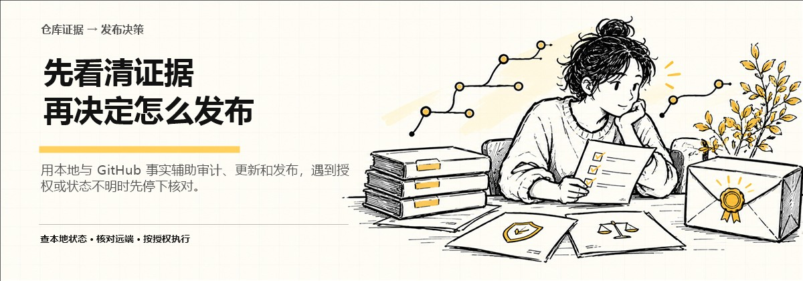

# GitHub 开源项目安全发布 Skill

> 在整理、审查和发布 GitHub 项目时，先核对实际文件与远端证据，再按明确授权执行。

  [](LICENSE)




[English README](README.en.md) · [English cover](assets/portfolio-promo-2026-11-02/cover-en.jpg) · [English overview](assets/portfolio-promo-2026-11-02/overview-en.jpg)

这是一个供支持 Agent Skills 的 AI 工具使用的开源项目发布 Skill。你给它一个明确的仓库和任务，它会先梳理本地与 GitHub 证据，再协助准备审查、更新、迁移或发布步骤。涉及远端写入时，必须由你明确授权具体目标与文件范围。

[安装](#六安装与快速开始) · [只读检查](#七如何使用) · [版本](#十一版本说明)

> 本项目是社区 Skill，不是 GitHub 或 OpenAI 的官方产品。它不替你绕过账号验证、平台限制或仓库保护。

## 一、这个项目是什么？

它是一套供 AI Agent 使用的项目发布操作指南。Skill 是指导 AI 按指定流程处理工作的说明文件，需要在支持 Agent Skills 的工具中安装和调用；它不是 GitHub 网页应用，也不会脱离 AI 工具自行运行。

它覆盖只读审查、准备项目更新、PR/Dependabot 审查、迁移与 Release 等任务。具体执行能力还取决于当前环境提供的本地工具、GitHub 连接和权限。

## 二、先看效果


> AI 概念插画：表现“本地检查—远端核对—逐项授权—结果复查”，不是实际发布成功截图。

典型输入包括目标仓库、要做的事、允许修改的路径和当前项目状态；输出可以是审查结论、修改清单或经授权操作后的结果。插画不代表 GitHub 已写入或发布。

## 三、适合谁用？

### 特别适合
- 需要把 AI 生成的项目整理成可审查、可维护 GitHub 仓库的创作者。
- 经常处理 README、许可证、徽章、分支、PR 或版本发布的人。
- 希望写入前看到准确文件清单，并保留人工授权边界的项目维护者。

### 不适合
- 想让 AI 不经审查自动推送整个工作区的人。
- 希望绕过账号验证、分支保护、Push Protection 或平台规则的人。
- 当前 AI 工具不支持 Skills，也无法提供所需 GitHub 或本地工具的人。

## 四、你会得到什么？

按任务不同，你会得到只读审查意见、证据支持的改进清单、徽章核验结果、待发布文件清单，或经授权操作后的远端结果。徽章评估脚本可以输出 JSON；本地报告和断点续跑行为见 [说明](references/local-reports-and-resume.md)。

## 五、它能帮你解决什么问题？

发布前常见的麻烦是本地内容与远端状态不同步、改错分支、遗漏许可证，或把未验证的 CI 徽章当成事实。这个 Skill 把证据核对、范围确认和授权拆成清楚步骤。

它能帮助你先看清哪些文件会发生变化；提交、推送、合并、发布和迁移仍需符合你的任务授权，并由你检查最终结果。它不能保证账号永不受限或发布必然成功。

## 六、安装与快速开始

需要一个支持 Agent Skills 的 AI 工具。若使用本地 GitHub 写入，还需要相应 Git 工具、GitHub 连接或已配置的认证；具体取决于你的环境。

使用可信的 Skill Installer 导入本仓库根目录，或把 Skill 文件按工具要求安装到 Skills 目录。安装后确认 <code>SKILL.md</code>、<code>agents/</code>、<code>references/</code>、<code>scripts/</code> 和 <code>templates/</code> 等文件可读取。随后先做只读审查：

```text
$github-oss-release
TASK_TYPE = PRE_PUBLISH_AUDIT
Target = <owner>/<repository>
Action = audit only; no GitHub write
```

把尖括号中的仓库信息替换为目标；成功标准是先得到审查结论，而不是发生远端改动。

## 七、如何使用？

中文示例：

```text
$github-oss-release
请只审查当前项目的 README、许可证、徽章和远端分支状态。
目标仓库：<owner>/<repository>
先给我证据与准确文件清单，不要提交或推送。
```

如果后续确实要写入，应给出目标分支、允许变更的确切文件和明确动作；每次提交、推送、合并或发布前都检查实际差异。含糊授权或超出范围的改动应停止。

## 八、项目工作流程

确认目标与任务 → 阅读本地项目和远端证据 → 分类风险与缺失信息 → 生成审查报告和文件清单 → 你确认具体写入范围 → 执行允许的步骤 → 复核远端结果。

只读审查不等于写入授权；Skill 也不会把任务类型自动当作授权。

## 九、项目目录结构

- <code>SKILL.md</code>：Skill 入口。
- <code>agents/</code>：Agent 配置。
- <code>references/</code>：发布、迁移、认证、徽章和 PR 处理说明。
- <code>scripts/</code>：徽章评估与校验工具。
- <code>templates/</code>：报告或项目文件模板。
- <code>tests/</code>：仓库自带的校验用例。

## 十、注意事项与常见问题

- **能保证账号安全吗？** 不能。它能帮助发现部分风险并拒绝越界操作，但不能保证平台不会限制账号。
- **会自动打 Star、发 Issue 或评论吗？** 不会把这些操作作为自动推广；不符合平台规则的请求不应执行。
- **CI、CodeQL 和覆盖率徽章可以直接加吗？** 不行。先要有与目标仓库、工作流和状态相符的证据；没有证据时不把徽章当装饰添加。
- **认证失败怎么办？** 检查账号、仓库权限和本地认证状态；遇到 401/403/429 或平台保护时按说明停止，不尝试绕过。
- **会把私密报告推到仓库吗？** 本地报告默认不应进入公开仓库；每次仍需核对提交文件清单和忽略规则。

仓库采用 [MIT License](LICENSE)。

## 十一、版本说明

仓库 README 标明当前 Skill 版本为 <code>2.2.0</code>。详细变更见 [CHANGELOG.md](CHANGELOG.md)。版本号说明 Skill 文件版本，不代表 GitHub 平台版本。

## 十二、相关项目

- [GitHub Backup](https://github.com/yangjing6213-dev/GitHub-Backup)：在 Windows 本机备份有权访问的 GitHub 仓库；适合在迁移或维护前留存副本。
- [Codex Provider Manager](https://github.com/yangjing6213-dev/Codex-Official)：管理 Windows 上的 Codex Provider 配置；适合同时维护本地 AI 工具环境的人。

## 十三、关于作者

**Enhe（恩禾）｜产品设计师 · 一人公司实践者 · AI Builder**

用 AI 打造一人公司。

- GitHub：[yangjing6213-dev](https://github.com/yangjing6213-dev)
- X / Twitter：[Amenenhe_ai](https://x.com/Amenenhe_ai)
- 网站：[恩禾 ENHE AI](https://www.enhe-tech.com.cn/)
- 微信：Hu-Amen
- 邮箱：[amen.enhe@gmail.com](mailto:amen.enhe@gmail.com)

## 十四、继续探索

我把这套 Skill 用于整理项目发布流程，希望把容易遗漏的证据、授权和复核步骤讲清楚。如果你也在用 AI 维护或分享自己的项目，可以到 [恩禾 ENHE AI](https://www.enhe-tech.com.cn/) 继续看看相关创作与工具实践。

